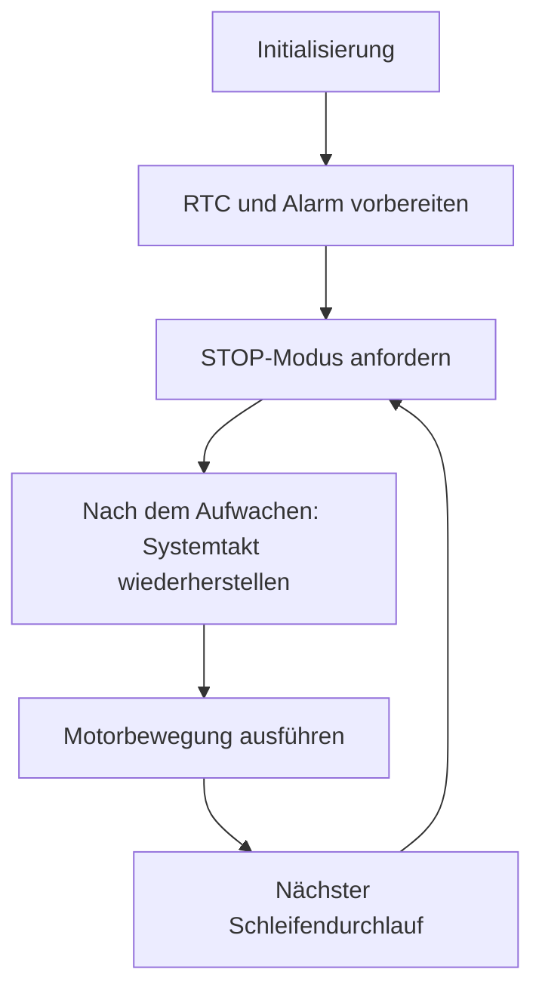

# STM32-Energiesparsteuerung mit Echtzeituhr

Dieses Embedded-Projekt untersucht den Wechsel eines STM32F103C8 in den
STOP-Modus und die anschließende Wiederaufnahme einer timerbasierten Motorsteuerung.
Die Firmware verbindet RTC, Backup-Domäne, Systemtakt und gekoppelte Timer
über eine registerbasierte Implementierung.

## Funktionen im vorhandenen Code

- RTC mit LSE-Konfiguration, Alarm und Backup-Registern initialisieren.
- Den STOP-Modus mit deaktiviertem SysTick und `WFI` anfordern.
- Den Systemtakt nach dem Aufwachen wiederherstellen.
- Die Motoransteuerung über TIM1 und TIM3 ausführen.

## Technischer Aufbau

| Bestandteil | Verwendung |
|---|---|
| Mikrocontroller | STM32F103C8Tx |
| Programmierung | Registerzugriffe mit CMSIS-Headern |
| Zeitbasis | RTC mit LSE-Konfiguration |
| Energiesparbetrieb | STOP-Konfiguration und `WFI` |
| Wiederanlauf | Funktion zur Wiederherstellung des 72-MHz-Systemtakts |
| Motorsteuerung | Gekoppelte TIM1-/TIM3-Funktionen |

## Vorgesehener Programmablauf



Der Ablauf zeigt die im Code vorgesehene Folge. Wiederholtes Aufwachen und
der vollständige Energiesparzyklus sind noch praktisch zu prüfen.

## Projektdateien

| Pfad | Inhalt |
|---|---|
| `firmware/pwr7_stop_rtc/Core/Src/main.c` | Initialisierung und STOP-Schleife |
| `firmware/pwr7_stop_rtc/rtc/rtc.c` | RTC, Backup-Register und Alarm |
| `firmware/pwr7_stop_rtc/rtc/stepper.c` | Timerbasierte Motoransteuerung |
| `firmware/pwr7_stop_rtc/Core/Src/X_stm32f1xx_system.c` | Systemtakt und Wiederanlauf |
| `tools/build.py` | Build mit Arm-GCC ohne IDE |
| [Hardwarebeschreibung](docs/HARDWARE.md) | Aus dem Code abgeleitete Anschlüsse |
| [Prüfplan](docs/VALIDIERUNG.md) | Offene Punkte und vorgesehene Messungen |
| [Build-Protokoll](BUILD_STATUS.txt) | Dokumentierte Build-Ergebnisse und Warnungen |

## Projekt bauen

### Mit Python und Arm-GCC

Voraussetzungen sind Python 3 und `arm-none-eabi-gcc` mit Newlib/Nano-Specs.
Der Compiler muss im PATH liegen. Alternativ kann `ARM_GCC` auf die
Compilerdatei gesetzt werden. Im Repository-Verzeichnis ausführen:

```powershell
python tools/build.py --profile Debug
python tools/build.py --profile Release
```

Die Firmware-Dateien werden unter `build/<Profil>/` erzeugt. Dieser Ordner
ist durch `.gitignore` ausgeschlossen.

### Mit STM32CubeIDE

1. `firmware/pwr7_stop_rtc` als bestehendes Projekt importieren.
2. Den internen Projektnamen `pwr7_stop_rtc` beibehalten.
3. Debug und Release bauen und die Toolchain-Version dokumentieren.

## Entwicklungs- und Prüfstand

Debug und Release wurden laut Build-Protokoll vom 03.11.2026 mit Arm-GCC 12.3.1
kompiliert und gelinkt. Compiler- und Linkerwarnungen sind dokumentiert.
Ein vollständiger STM32CubeIDE-Import und Hardwaretests dieser Kopie stehen aus.

Der vorhandene RTC-Alarm wird einmalig gesetzt; der Alarm-Callback ist leer.
Folgealarme, Aufwachquelle, Schlafverhalten innerhalb des Motor-Callbacks und
die Taktwiederherstellung sind deshalb Bestandteil des [Prüfplans](docs/VALIDIERUNG.md).
Messwerte für Stromaufnahme, Aufwachzeit oder Energieeinsparung liegen noch nicht vor.

Für die Hardware-Demonstration sind das tatsächliche Board, die Taktquellen,
der Motortreiber und der Messaufbau zu dokumentieren.

